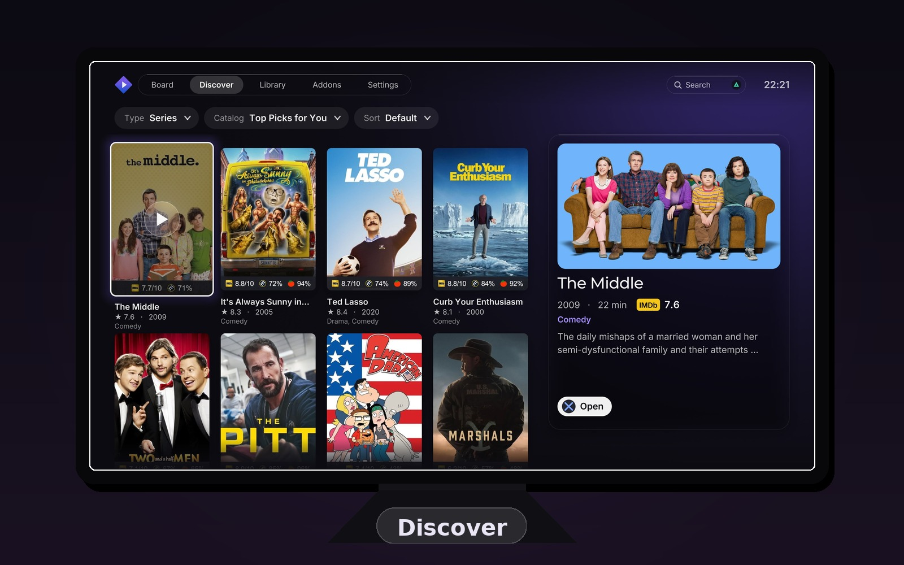
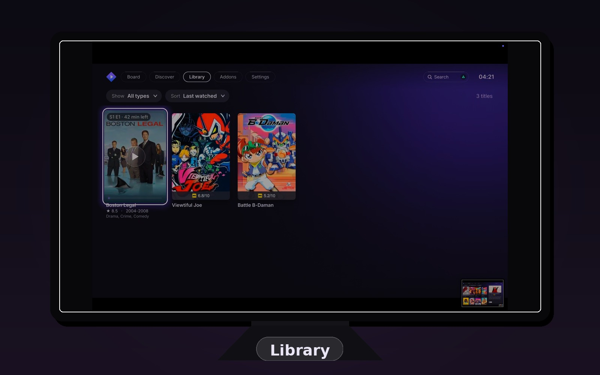
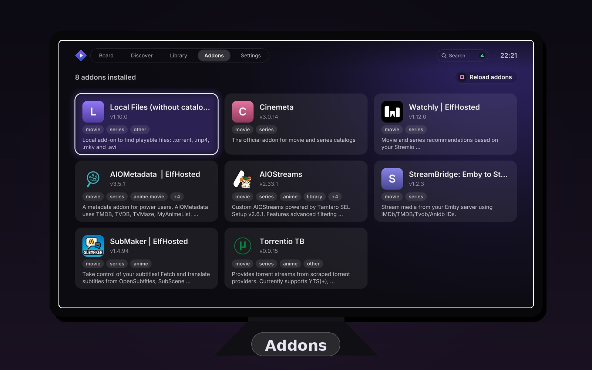

# Not Stremio

**A fork of [Sp9nky's unofficial Stremio PS5 port](https://github.com/Sp9nky/unofficial-stremio-ps5-port), focused on Thai subtitle support, playback performance, and a glass interface.**

> [!IMPORTANT]
> **Credit where it's due.** The original port — the app itself, its design, its torrent engine, its UI — was built by **Sp9nky**. Everything here stands on that work. If you like this app, support the upstream author:
>
> [](https://ko-fi.com/sp9nky)
>
> Bug fixes from this fork are contributed back upstream where appropriate (e.g. the Thai subtitle fix, [upstream PR #10](https://github.com/Sp9nky/unofficial-stremio-ps5-port/pull/10)).
>
> The glass visual language is inspired by [Fxy6969's "liquid-glass" Stremio theme](https://github.com/REVENGE977/stremio-enhanced) (via Stremio Enhanced) — re-implemented natively for the PS5 UI toolkit, not copied.

A Stremio client for jailbroken PlayStation 5 consoles, running as a native app on the home screen: browse your catalogs and library, pick a stream, and watch it, all with the DualSense.

> **Unofficial.** This project is not affiliated with, endorsed by or supported by Stremio, or by Sony Interactive Entertainment. It has no connection with either. "Stremio" and its logo are trademarks of their owner; "PlayStation", "PS5" and "DualSense" are trademarks of Sony Interactive Entertainment Inc. No Sony code, SDK, keys or firmware files are included.

## What this fork focuses on

- **Thai language support.** TIS-620 subtitle decoding, Noto Sans Thai bundled into the font chain, and combining-mark shaping via the font's GPOS anchors.
- **Playback performance.** Parallel chunk downloading, progressive streaming (playback starts on the first bytes), pre-warmed stream URLs and TLS connections, sub-0.5s seeks.
- **Continuity.** Seamless in-player episode transitions, next-episode pre-resolve with a stream matcher, one-press Continue Watching resume, Up-Next countdown.
- **Reliability.** In-RAM stream ring buffer, non-blocking player teardown, fixes for buffer and seek freezes.
- **Intro/outro skip.** Anime via AniSkip, everything else via TheIntroDB, embedded chapters as offline fallback.
- **Picture.** Upscaler options (Cinema HQ bicubic + CAS, FSR1 + sharpening, Anime4K shaders), SDR tone-mapping polish, HDR10 diagnostic probe.
- **Interface.** Glass visual language (frosted surfaces, rim light, cinematic hero), top pill navigation, instant search, live setting descriptions.

## Complete list of changes vs upstream

### Subtitles & language
- Thai subtitle decoding (TIS-620) instead of mojibake
- Noto Sans Thai bundled into the UI font chain
- Thai combining-mark shaping via the font's GPOS anchors ([upstream PR #10](https://github.com/Sp9nky/unofficial-stremio-ps5-port/pull/10))
- Subtitle pre-parse before playback starts
- L2/R2 subtitle delay ±0.25s in player

### Startup & boot
- Board boots from a snapshot of the last session (schema v3: cursor + Continue Watching, atomic write on shutdown)
- No loading logo, no startup chime
- Addon manifests cached to disk; 0.75s boot gate
- Offline-resilient Board/Detail when the network is down

### Navigation & menus
- Top horizontal pill navigation
- L1/R1 switches pages on all 5 tabs; L2/R2 jumps Settings sections
- ○ from any page returns to the Board
- Triangle opens Search from anywhere, including the top rail

### Board
- Row lifecycle states (cached / validating / synced / offline) with shimmer and sync pill
- Continue Watching order-locked; one-press resume on up-next cards
- Full-viewport hero with centered fading dots; logo capped at 560px/130px with metadata clearance
- Detail ambilight + Metahub artwork fallback; 16:9 Continue Watching cards
- Viewport-aware artwork prefetch (priority queue, asymmetric scroll window)

### Search
- Index pre-built at boot; no input debounce
- Streaming results with 6s addon timeout and cursor-stable incremental rows
- IME busy-race retry; sync local fallback scan; 5s search timeout

### Streaming engine
- 6 parallel chunk downloads, 2MB chunks
- Progressive streaming — playback starts on the first bytes (128KB playhead window)
- 128MB in-RAM ring buffer; no on-disk stream cache files
- Pre-warmed stream URLs and TLS connections (20-min cache, self-populating, re-warmed when the Up Next card appears)
- First chunk gets an 80ms worker head start
- Debrid: speculative pre-resolution on 250ms dwell; urgent-chunk tail-seek protection; 256KB curl buffers with warm connection pool
- Torrent: softer first rebuffer (5s); 32MB single-connection read-ahead

### Playback
- Seek: 0.25s start gate, 15s keyframe snap, stale-frame drain on seek
- Playback speed control; watched-sync
- Hardware decoder: unconditional slot renewal on flush; VDEC frame-buffer DMA race fixed
- Audio: HDMI init handling; zero-copy IEC61937 bursts; halved passthrough sleeps

### Episode continuity
- Seamless in-player Play Next (video frame held, no loading modal; 8s stall fallback)
- Next-episode pre-resolve at 80% playback with a 4-tier stream matcher (info_hash → binge_group → same addon+resolution+name → same addon+resolution)
- Up-Next countdown card; Cross = auto-play / Square = choose-stream on episode lists

### Intro / outro skip
- Anime: intro/outro timestamps via the AniSkip API (series resolved to MyAnimeList IDs through Kitsu mappings, with a Jikan title-search fallback; mappings cached per series)
- All other shows and movies: skip segments via TheIntroDB (IMDb IDs, with a series-ID → video-ID → loaded-metadata fallback chain to find the ID)
- Embedded container chapters recognized too (intro/opening/theme, recap/previously, outro/ending/credits) — works offline; an online result only replaces them when non-empty
- Modes Off / Prompt / Auto (Settings → Playback); intro and recap auto-skip, credits and preview prompt-only to protect post-credit scenes
- Amber bands on the seekbar mark skippable segments; Triangle prompt card while the OSD is visible; skip chunks pre-warmed so the jump is instant
- Stats for Nerds reports skip state per episode (e.g. which ID scheme was used, or why lookup was skipped)

### Picture
- Upscaler options: Cinema HQ (anti-ringing bicubic + RCAS), FSR1 + sharpening, Anime4K shaders
- Bilateral chroma upsampling + debanding; Dolby Vision P5 fix; gamut-safe tone mapping
- SDR tone-mapping polish; HDR10 diagnostic probe; 8-bit SDR shader fast path
- OSD upscaler badge + nerd stats; volume OSD and hint bar clearance

### Settings
- Live per-choice descriptions under every setting (12 helpers: upscaler, sharpening, tone mapping, audio, etc.)
- Artwork disk cache capped at 512MB with boot-time prune; cache size refreshes live on the Settings page
- Accessibility settings page; haptics and hints options; reduce-motion fade

### Reliability
- Non-blocking player exit (reaper thread) and detached stream teardown — opening the next episode never waits on the previous one's connections
- Fixed: Play-Next 65% buffer freeze, fast-forward freeze at full buffer, large-file crash
- Thread-safety: font calls kept on the GL thread; artwork mutex; disk I/O moved off-mutex with generation-validated pread/pwrite
- CA bundle cached; curl pool return fixed; `tls_verify=0` removed

### Accounts
- Multiple account profiles with per-profile state
- Sign-in modal rendering fixed (layering)

### Design language
- Glass theme: frosted surfaces, 1px rim light, soft shadows, neutral-black dimming
- Unified navigation capsule; stream picker with glass badges; Discover glass preview
- Inspired by Fxy6969's "liquid-glass" Stremio theme (via Stremio Enhanced) — re-implemented natively for the PS5 UI toolkit

## Screenshots

Real captures from the fork, framed:

| | |
|---|---|
|  |  |
| *Discover* | *Library* |
|  | |
| *Addons* | |

## Requirements

A jailbroken PS5 (see upstream [requirements](https://github.com/Sp9nky/unofficial-stremio-ps5-port#requirements)).

## Install

1. Download `PPSA77711.ffpfsc` from the [Releases](../../releases) page.
2. Copy it to `/data/homebrew/` on the console (FTP, PS5 Upload, ...).
3. ShadowMountPlus registers it: start **Not Stremio** from the **Games** section of the home screen.
4. In **Settings**, sign in to your Stremio account.

To update, close the app first, delete the old `PPSA77711.ffpfsc`, wait a few seconds, then copy the new one. (If the image is replaced while the app is running, the console keeps the old icon and backgrounds.)

The app keeps its settings, artwork cache, read-ahead caches and log in its own storage (`/download0/stremio`, up to 16 GB), the same place as before, so your sign-in should carry over; if it doesn't, sign in again.

> [!NOTE]
> This fork keeps the title ID `PPSA77711`, so it installs into the same slot as upstream 1.0 (game-type title, **Games** section). Your settings and login carry over.

## Controls

| Where | Button | Action |
| --- | --- | --- |
| Everywhere | ✕ / ○ | select / back (○ from any page goes to the Board) |
| | D-pad, left stick | move |
| | △ or Options | search |
| Board | □ | See all (not on Continue Watching) |
| | ✕ on a Continue Watching card | play now / choose another episode / choose another stream |
| | Options, on a Continue Watching card | remove it (asks first) |
| Addons | □ | reload the addons |
| | ✕ on an addon you added by URL | remove it |
| Title page, episodes | ✕ | choose the episode |
| | L1 / R1 | previous / next season |
| | △ | mark the episode watched / not watched |
| Title page, streams | ✕ | play |
| | □ | play with the streaming server |
| Player | ✕ or touchpad | pause / play |
| | D-pad left / right | seek 10 s |
| | L1 / R1 | seek 1 min |
| | L3 | back to the start |
| | □ / △ | next subtitle / next audio track |
| | L2 / R2 | subtitle delay -/+ 0.25 s |
| | D-pad up or Options | track menu |
| | ○ | stop |

## Building

Same toolchain as upstream (PS5 SDK + clang-18, see upstream [Building](https://github.com/Sp9nky/unofficial-stremio-ps5-port#building)). From the repo root:

```bash
bash build.sh
```

## Status and known limitations

Same as upstream, plus: this fork is tested on-device by its maintainer, but every release is a work in progress.

## Credits and licenses

- **Sp9nky** — author of the [unofficial Stremio PS5 port](https://github.com/Sp9nky/unofficial-stremio-ps5-port) this fork is built on. All core app credit goes upstream.
- **Fxy6969** — author of the "liquid-glass" Stremio theme (via [REVENGE977/stremio-enhanced](https://github.com/REVENGE977/stremio-enhanced)) that inspired this fork's glass visual language. Re-implemented natively; no theme code was copied.
- This fork's changes (Thai subtitle support, performance and reliability work) by ChillQuant, contributed back upstream where suitable.
- Licensed under **GNU GPL v3** (see [LICENSE](LICENSE)), same as upstream. Forking and modifying is exactly what the license is for.
